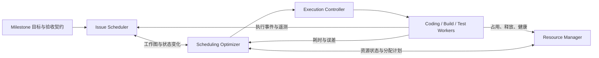

# MileSprint

**Milestone-first, resource-aware, continuously replanned development.**

MileSprint（暂定名）是一套面向**单机、单项目、单个 Milestone 冲刺**的 Agent 协作开发工作逻辑。其目标并非最大化同时运行的 Agent 或已关闭的 Issue 数量，而是在用户定义的范围、质量和安全约束下，**尽可能缩短整个 Milestone 从开始到最终人工验收通过的实际耗时**。

## 当前状态

> **Design only / 设计阶段**。v0.0.1 的产品边界与关键规则已确认，仓库目前只有设计文档，**尚无软件实现、正式发布、可运行产物或性能实验结果**。

`docs/releases/v0.0.0/` 为初始概念记录，不代表 `v0.0.0` 已经发布。

## 三大核心模块

1. **Issue Scheduler**：管理动态 Issue/Action 图、澄清与执行状态、依赖发现及事件驱动推进。
2. **Resource Manager**：注册、匹配、预约并安全管理本地开发环境中的计算资源、模拟器、真机和共享逻辑资源。
3. **Scheduling Optimizer**：根据依赖、估计耗时、可用资源和真实执行遥测，持续规划和重规划以减少 Milestone 完成时间。

## 设计文档

从 [v0.0.0 初始概念索引](docs/releases/v0.0.0/README.md) 开始阅读。该目录包含产品定义、工作模型、资源模型、优化模型、集成验收、运行时协议、验证实验及决策记录。

当前首版设计见 [MileSprint v0.0.1](docs/releases/v0.0.1/README.md)：产品与服务名称保持 MileSprint，本版只暴露设备管理能力。已围绕本机 doumen 的两台 USB 真机和 DeviceHub 完成实施前调研，尚未开始正式实现。

## 项目管理

使用 [MileSprint Issue 看板](https://github.com/users/ceasarXuu/projects/6) 按“版本 → 主题（feature / fix）→ issue”组织工作。看板入口、视图配置与维护方法见 [GitHub Project 操作手册](runbooks/github-project.md)。

## 原则

- **Milestone-first**：Issue 优先级不等于执行优先级；优化完整版本的交付时间。
- **Resources-first**：Agent 可弹性扩容，开发环境中的设备、算力、共享状态等资源往往才是实际限制。
- **Evidence-driven**：预测与事实分离；真实执行耗时、依赖和验证结果持续修订计划。
- **Human-on-necessity**：只有必须由用户决定的需求语义、系统外事实和授权等才请求人工介入。
- **Safety before speed**：资源安全、数据分级、验收条件与用户权限是不允许违反的硬约束。

## 许可

仓库内容按 [MIT License](LICENSE) 授权。许可不代表当前存在可用软件。
