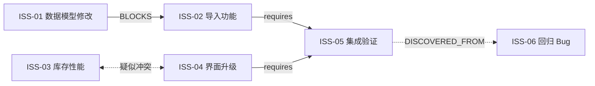

# 02 · Issue、Action 与动态关系图

## 1. Issue 是最小逻辑事务，Action 是最小调度单位

- `Milestone`：交付目标、范围、完成条件、验证门禁与用户验收。
- `Issue`：Feature、Bugfix 或其他独立逻辑事务，可能尚未澄清或未定位。
- `Action`：对 Issue 的具体动作，如 `INVESTIGATE` / `IMPLEMENT` / `BUILD` / `TEST` / `INTEGRATE` / `REQUEST_HUMAN_INPUT`；可具有单独耗时、资源、依赖和验证输出。

不要求在 Sprint 起点就预先拆解全部 Action；Agent 随认识增长进行渐进式拆解。

## 2. Issue 用户可见状态（保留最初讨论）

| 状态 | 进入条件 | 退出条件 |
|---|---|---|
| `NEEDS_CLARIFICATION` 待用户澄清 | 必要需求语义或只有用户才能提供的外部事实未明确 | 用户回答、给出指示，或确认无需澄清 |
| `READY` 待实施 | 当前阶段已取得足够上下文，但可能等前置依赖或资源 | 满足调度条件后进入实施 |
| `IN_PROGRESS` 实施中 | 有明确可做的代码、文档、编译、测试、调查工作 | 成功、进入下阶段，或出现无法自动解决的情况 |
| `BLOCKED` 阻塞 | 分析后无法在现有约束下自主继续，必须等待用户决策 | 用户指示或约束变化 |
| `CLOSED` / `CANCELLED` 关闭/取消 | 验收条件满足 / 用户明确放弃 | 新证据推翻关闭结论时可以重新打开 |

**不要混淆状态与调度条件**：`READY` Issue 可能在等前置 Issue 或资源；`NEEDS_CLARIFICATION` Issue 仍可能有可独立推进的调查 Action。内层另存 `WAITING_DEPENDENCY`、`WAITING_RESOURCE`、`RUNNING`、`VERIFYING` 等 Action 执行状态。

**待用户澄清 vs 阻塞**：前者是缺少需求定义/外部信息；后者是分析后在权限、目标、技术限制或风险约束下无法达成，需要用户明确裁决，不是普通排队等待资源。

## 3. 动态 Issue/Action Graph

建议起始支持：

| 关系 | 方向 | 意义 |
|---|---|---|
| `BLOCKS` | 有向 | 硬前置依赖；可以附加阻塞的具体 Action/阶段 |
| `RELATES_TO` | 无向 | 共享语义或上下文，不自动阻止并行 |
| `AFFECTS` | 有向 | 上游变更可能使下游工作、假设或验证失效 |
| `CONFLICTS_WITH` | 对称 | 特定 Action 并行存在共享写入、设备或数据风险 |
| `DISCOVERED_FROM` | 有向 | 新 Issue 的发现来源，可追溯测试轮次、Action 和日志 |

边包含：`from`、`to`、`type`、`evidence`、`confidence`、`proposed_by`、`last_verified_at`，以及何时生效的条件。关系可以是用户确定、Agent 推测、经过工具验证三种证据级别。

**不要把低置信度的关联无条件升级为硬依赖。** 对疑似冲突可以先派发低成本 `INVESTIGATE` Action；确认以后再更新约束并触发重规划。所有硬依赖更新应检测环并要求修正；允许语义关联图存在环。

## 4. 主动关系发现

Agent 可以在读取代码/日志/测试和执行结果时：

1. 发现 Issue 影响了相同模块、数据表、API 契约或测试环境。
2. 生成带证据和置信度的关联假设。
3. 估计该假设对当前排程的影响（若确认，将释放并发，还是造成串行）。
4. 选择继续执行、先验证关系、暂停受影响 Action 或重新排程。
5. 如发现未覆盖的问题，新增 Issue 并记录 `DISCOVERED_FROM`。

这样 Issue Graph 不只是展示，而是优化器的动态约束来源。

## 5. 实例

上述是说明性示例。`ISS-03` 与 `ISS-04` 可先进行只读调查以明确关系，未确认前不必全局停止。

## 6. Issue 关闭不等于 Milestone 验收

Issue Closed 代表局部完成证据充分；Milestone 还需对当前集成版本执行 R1/R2/... 验证并由用户验收。因集成新证据推翻某 Issue 的完成条件时可以重开；与原完成条件不同的新缺陷则新建 Issue 并建立来源关系。
