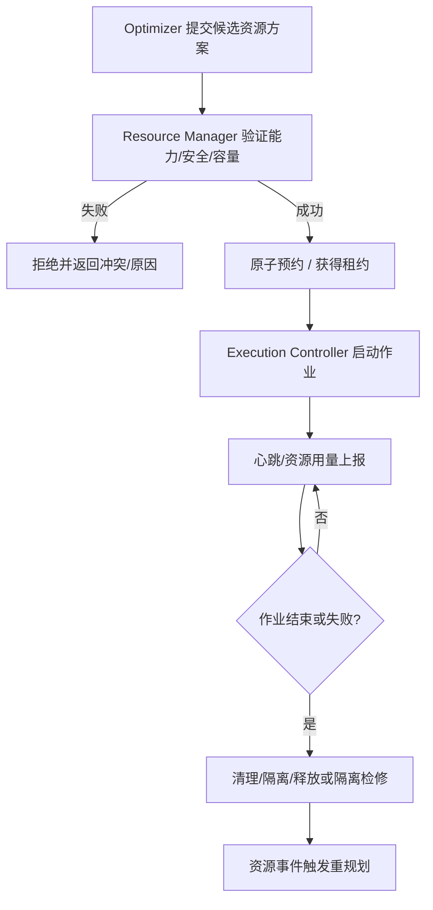

# 03 · 资源注册、能力匹配与安全分配

## 1. 为什么资源是一等公民

编码 Agent 在一定范围内能较容易增加，但单机开发环境的物理和逻辑资源通常不能无限增加。例如：3 台模拟器和 2 台真机可能有不同 Android/iOS 版本、硬件能力、测试数据安全等级；某些模拟器共用 CPU、内存和 I/O，某些真机需要独占。

Resource Manager 的责任不只是维护 `locked = true/false`，还包括**注册、能力匹配、健康检查、资源容量、预约、分配安全、租约、故障恢复及遥测**。

## 2. 一份示意注册表（非真实设备清单）

| Resource ID | 类型 | 系统/版本 | 能力 | 测试数据等级 | 并发容量 |
|---|---|---|---|---|---|
| `vm-01` | Android 模拟器 | Android 13 | UI 自动化、普通网络 | public / synthetic | 1 |
| `vm-02` | Android 模拟器 | Android 15 | UI 自动化、截图 | public / synthetic | 1 |
| `vm-03` | Android 模拟器 | Android 16 | UI 自动化、性能基础测试 | public / synthetic | 1 |
| `phone-01` | Android 真机 | Android 15 | 蓝牙、通知、相机 | public / synthetic / internal | 1 |
| `phone-02` | Android 真机 | Android 16 | 真机性能、传感器 | public / synthetic / internal | 1 |
| `host` | 宿主机 | Linux/macOS/Windows | CPU、RAM、GPU、磁盘和构建工具链 | 由工作区策略决定 | 连续容量 |

以上数据用于演示，不代表已探测到任何真实设备；OS 版本也应按安装环境实际探测与维护。

## 3. Resource Schema（讨论稿）

```yaml
id: phone-01
kind: physical_device
parent_id: lab-host-01
capabilities:
  platform: android
  os_version: "15"
  arch: arm64
  features: [camera, bluetooth, notifications, ui_automation]
security:
  allowed_data_classes: [public, synthetic, internal]
  cleanup_required: true
  trust_zone: local-trusted
allocation:
  mode: exclusive
  capacity: 1
  supports_reservation: true
  lease_ttl: 30m
  preemptible: false
health:
  state: healthy
  checked_at: null
```

实际运行时，还需记录 serial/device ID、驱动及工具链、可测试 App/平台范围、使用限制、连续容量成本、Setup/Cleanup 延迟和当前租约。

### 能力与安全必须是硬约束

- 不可把虚拟设备当作具备真实蓝牙/传感器的真机使用。
- Action 要求的数据敏感性不能高于设备/工作区授权等级。
- 资源重新分配前必须执行必要的清理和隔离；清理失败则标记 `quarantined`，不能立即回到 `available`。
- 设备声明的允许数据等级和信任域由用户配置或安全策略授予，不能由 Agent 为了方便自行提升。

## 4. 资源是层级结构，不能重复计算容量

三个各需 5GB RAM 的虚拟机并行启动时，即使每台虚拟机单独显示空闲，也可能共用仅有 16GB 可调度内存的宿主机。资源占用模型需支持：

- `parent_id` / 共享宿主机。
- `exclusive`（独占设备、端口、签名工具等）。
- `cumulative`（CPU/RAM/GPU 显存、I/O 配额）。
- `alternative`（同一测试可由多台能力兼容设备执行，但速度不同）。
- `affinity / anti-affinity`（某 Action 必须使用特定设备，或不得与某任务共置）。
- `setup/cleanup`（安装、重启、擦除数据等占用时间和安全成本）。

逻辑资源也需要管理：Git 集成分支写入权、共享数据库 Schema、Fixture、Build Cache、不可变代码快照及特定测试环境的修改权。**同文件改动不必然互斥**：隔离 Worktree 可并行修改，但共享集成状态需要序列化或兼容性验证。

## 5. 分配、预约与租约

### 分配流程



`Lease` 至少包含：`resource_id`、`holder/action_run_id`、`expires_at`、`heartbeat_at`、`fencing_token` 和 `lease_generation`。同一资源只接受**最新有效代际**的操作。对真机或其他外部系统，如果其原生 API 无法校验 token，需通过受控代理、进程终止、重置和隔离来阻断过期进程；不能仅依赖超时删除锁。

### 资源持有原则

- **按 Action 申请，不按整个 Issue 长期持有**：调查阶段不占用真机，构建完成后才预约真机进行测试。
- **尽量延迟持有时间**：等待编译时释放不再需要的设备，避免无收益的占用。
- **允许有计划的空闲**：即将运行的关键路径 Action 可能值得预留一台设备，不必让 Ready-First 任务抢占。
- **租约过期不等于动作安全停止**：外部副作用操作必须先确认终止或隔离。

## 6. 死锁避免不等于资源最优

传统银行家算法需要事先知道最大资源需求；对根因未知、资源需求会动态变化的 Bugfix，这通常不完全成立，因此不宜直接将银行家算法视为系统核心。

优先讨论组合：

1. **原子资源包申请**：同时需要数据库写锁和一台手机时，要么同时获得，要么都不获得，减少 hold-and-wait。
2. **资源类型全局顺序**：需要逐个获取的锁遵守一致顺序，避免循环等待。
3. **资源分阶段申请/释放**：缩短持有时间，降低竞争。
4. **Wait-for Graph 监测**：识别已产生的等待环；按安全可回滚性与代价选择撤销/重试，而非随意杀死不可中断作业。
5. **Lease + fencing + health**：解决 Worker 死亡及过期持有者继续操作的风险。

原子获取无法适用于未来需求未知的所有任务；这种情况仍需重规划、超时、人工批准和故障隔离机制。

## 7. Resource Manager 与 Optimizer 的权限界线

- **Resource Manager 有最终的安全裁决权**：不可因调度器要求而违反能力、数据分级、容量或租约不变量。
- **Optimizer 有计划排序权**：选定资源何时预约、何时执行、优先给哪个 Action 使用。
- Resource Manager 不自行决定 Milestone 的业务优先级；Optimizer 不更改资源安全政策。

## 8. 待进一步验证

不同设备是否可安全共享 USB 代理、单主机虚拟机实际可并发数量、构建缓存冲突粒度、资源撤销策略、清理耗时和设备能力自动探测准确度，均应通过实验获得，而非在文档中预先承诺。
