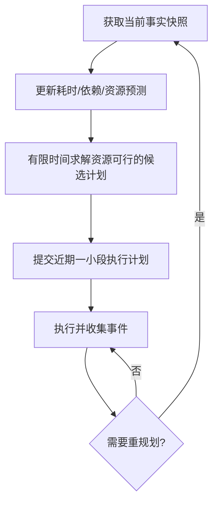

# 04 · 版本最短完成时间与持续重规划

## 1. 核心优化目标

目标不是最高 Agent 利用率、最多 Issue Closed、最少资源空闲或按用户 Issue 优先级顺序执行，而是在用户批准的版本范围与验收契约下：

\[
\min_{\pi}\;\mathbb{E}[T_{\mathrm{accepted}}(\pi)]
\]

其中 \(\pi\) 是动态调度策略。`T_accepted` 包含各 Action 执行、依赖等待、必要重测、集成回归和最终用户验收等待。**用户定义的质量、安全、范围和权限是硬约束**；不能以缩短时间为由牺牲。

该模型近似于**在线、随机、带替代资源与动态任务发现的 RCPSP（Resource-Constrained Project Scheduling Problem）**。传统 RCPSP 的任务集合、依赖和耗时通常更确定，而研发中存在隐性依赖与高度不确定的 Bug 根因。

## 2. 输入与输出

| 输入 | 说明 |
|---|---|
| Work Graph | 未完成 Issue/Action、前置与互斥关系、完成条件、可暂停性 |
| Resource Snapshot | 能力、容量、租约、预约、健康、Setup/Cleanup、共享宿主资源 |
| Time Estimates | 预测分布（至少 p50/p90 或区间）、置信度、相似历史记录 |
| Actual Telemetry | 已完成 Action 的等待、Setup、运行、Cleanup 与失败重试耗时 |
| Acceptance Contract | 质量/测试/安全/权限/版本范围 |

输出：`SchedulePlan`（哪些 Action、何时执行、选用哪类或哪台资源、前置检查、计划有效期限、预计关键路径、重排原因及备选方案）。

## 3. 必要约束

- `precedence`：前置 Action 完成才可运行相应后置阶段。
- `exclusive / cumulative`：独占设备及宿主共享容量不可超额。
- `capability`：操作系统版本、硬件能力、测试类型、安全等级必须匹配。
- `non-preemptible`：执行中的不可中断测试/编译不能任意抢占。
- `setup/cleanup`：准备和清理时间及数据隔离是可调度开销。
- `code/version`：集成写入、基于代码快照的测试证据应遵守一致性约束。
- `business/quality`：未获得许可不得取消必做 Issue 或削减版本验收项。

一些同质资源可以共享容量；不同设备即使满足同样功能，其速度和前置安装成本也可能不同。调度需要允许**同一 Action 的替代资源选择与不同耗时估计**。

## 4. 不能只用静态关键路径

关键路径要考虑资源争用形成的**隐式先后约束**。即使 A、B 在 Issue Graph 中互不依赖，共用的唯一测试机仍可能迫使测试串行。优化器有时需要主动空闲/预约设备，优先给具有更长下游路径的任务。

### 说明性算例（不是实测）

A：先开发 20 分钟，再独占设备测试 60 分钟。  
B：先开发 30 分钟，再独占设备测试 20 分钟，随后还需开发 40 分钟。  
两者开发可并行，设备只有 1 台。

- Ready-First：A 占用设备 20–80，B 测试 80–100、后续开发 100–140；版本完工为 **140 分钟**。
- 下游关键路径优先：设备 20–30 预留，B 测试 30–50、B 开发至 90；A 测试 50–110；版本完工为 **110 分钟**。

这个示例证明策略有可能带来收益，不代表真实项目可稳定获得 21.4% 的加速。

## 5. Estimator：估时应给出不确定性而非单个数字

```yaml
action_id: ISS-12/test-android
prediction:
  p50: 8m
  p90: 20m
  confidence: medium
  basis: historical_similar_tests
actual_observation:
  queue_wait: 2m
  resource_setup: 1m
  execution: 3m
  cleanup: 1m
  total_resource_occupancy: 5m
```

**执行时长与资源占用时长不同**。预测与校准应按 Action 类型、设备、宿主负载、缓存状态、测试规模、Agent 模型和失败类型分层，不能因为一个测试从预估 20 分钟变成实际 3 分钟，就把所有同类任务的预计耗时改成 3 分钟。

Bug 调研可能具有长尾时间分布；编译与固定测试套件更适合从历史样本校准。不同 Action 的估时方式应不同。真实耗时必须与等待资源、准备、执行、清理以及重试费用分离存储。

## 6. Rolling-Horizon Scheduling



- **计划时域滚动**：只有近期开工安排是明确承诺；长期计划可调整。
- **优化时限**：规定求解预算，超时返回安全可行方案，不追求任何规模下证明全局最优。
- **快速反应层**：资源释放、Lease 回收、Action 完成后的 Ready 解锁尽量立即响应。
- **全局规划层**：依赖、新 Issue、资源故障、预测偏差显著影响完工时间时，执行更昂贵的重排。
- **抗抖动**：已经运行的 Action、已发放的租约原则上保持稳定；只有预估收益覆盖取消/切换/重新准备成本时才调整未开始工作。

求解器候选包括启发式调度与 OR-Tools CP-SAT 的 interval、`NoOverlap`、`Cumulative` 等约束建模；在数据规模和不确定性经基准测试之前，**不确定最终算法实现**。

## 7. 持续反馈事件

| 事件 | 优化器行为 |
|---|---|
| 预估 20 分钟的测试实际 3 分钟完成 | 提前释放资源，更新该类分布的观测，重新评估关键路径 |
| 设备故障或被隔离 | 排除该资源，寻找替代设备；无法满足则报告阻塞 |
| 新发现 `BLOCKS` 关系 | 更新先后约束，撤回尚未启动的不合法派发 |
| 发现 `RELATES_TO` 假设 | 评估先调查该假设的信息价值，而非直接创建硬阻塞 |
| 集成测试发现回归 | 创建/重开 Issue，重算剩余工作和验证需求 |
| 人工澄清到达 | 更新 Action 和验收约束，立即重新评估候选计划 |

## 8. 主动调查的不确定性收益

不是所有最优操作都在写代码。花 5 分钟确认两个 Issue 是否真正相互阻塞，可能释放 40 分钟并发收益。可以将低成本 `INVESTIGATE` Action 与直接实施放在相同的候选计划中，依据预期信息价值、误判风险、资源成本决定是否先调查。

## 9. 重要的限制

- 质量门禁优先于时间优化；不得通过不测、少测或自动取消范围换取更短记录时间。
- 不可把未证明的假设变成确定依赖而永久串行化。
- 不可将已运行的非抢占任务当作可以免费取消。
- 优化指标是**整个 Milestone 的墙钟时间**，而非每个局部步骤单独最短。
- 真实系统还有 API 限流、人类响应和验收窗口，不能把 Agent 数量视作数学上的完全无限。
