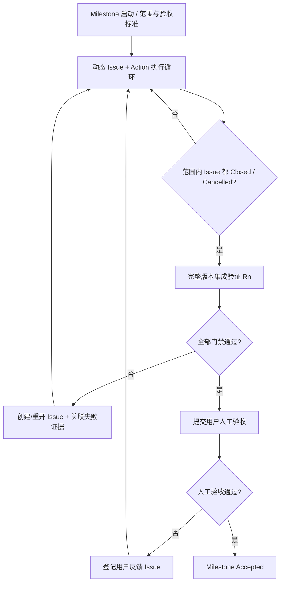

# 05 · Milestone 集成验证与人工验收闭环

## 1. Milestone Sprint 的完成条件

一个 Milestone 包含多个 Issue；Issue 从 `open` 经澄清、实施与验证，最终成为 `closed` 或 `cancelled`。所有范围内 Issue 达到终态后，开始一次完整版本集成测试 `R1`；若发现新问题，则产生新 Issue 或重开旧 Issue，回到执行循环；再进行 `R2`、`R3`……直到全量验证通过，再交由用户人工验收。人工验收如提出新 Issue，继续相同循环。



## 2. 多层验证，不应只等到 R1 才开始测试

- **Action 级**：格式检查、编译、单元测试、局部功能验证。
- **Issue 级**：以该 Issue 自身的接受标准闭环，产生与代码快照绑定的证据。
- **持续集成级**：受控合入后执行受影响的增量测试，尽早发现跨 Issue 回归。
- **Milestone Rn 级**：当前范围内所有 Issue 结束后执行完整版本集成验证，作为人工验收前门禁。
- **人工验收级**：由用户确认产品实际表现和外部上下文符合预期。

## 3. 证据必须绑定有效的代码状态

Issue Closed 不表示其验证证据永远有效。建议记录：

```yaml
verification_id: verify-123
issue_id: ISS-10
revision: git-commit-sha
scope:
  modules: [inventory, import]
  tests: [test_import, test_inventory]
result: passed
recorded_at: null
invalidated_by: []
```

当新代码改变依赖模块、API 契约、数据库 Schema 或共享环境时，判断哪些既有测试证据应失效，并自动生成必要的再验证 Action；避免盲目重测一切，也避免永久相信旧结果。

## 4. 集成发现的问题如何决定归属

| 新发现问题 | 处理策略（初始讨论） |
|---|---|
| 本 Milestone 变更引入的回归 | 加入当前 Milestone |
| 阻碍当前 Acceptance Contract 的 Bug | 加入当前 Milestone |
| 与本版本无关且不阻止验收的历史缺陷 | 建立 Backlog Issue，默认不扩大范围 |
| 用户提出的新功能 | 默认需要用户确认是否扩大冲刺范围 |
| 原 Issue 的完成结论被推翻 | 重开原 Issue 并链接失效证据 |

> 上表为建议政策，不是已确定的实现。具体严重级别、质量红线和必须进入本版本的范围，由用户 Acceptance Contract 决定。

## 5. 用户参与策略

- **需求澄清**：合并成尽可能少且可独立回答的问题，不重复请求可通过现有代码/日志/测试确定的信息。
- **等待用户期间**：继续执行所有不依赖用户回答且符合安全约束的调查、文档、测试准备等 Action。
- **真正阻塞**：对于无法自动解决的目标冲突、重大变更、不可逆操作或缺失授权，明确列出分析结论和可选决策。
- **人工验收**：不能由 Agent 用自己的通过结论代替用户最终批准。

## 6. 避免“永远无法结束”的 Sprint

Milestone 的 Acceptance Contract 必须包括范围边界、必做测试、缺陷放行规则、数据安全约束和用户批准权限。所有新问题都纳入当前 Milestone 会使范围无限扩展，因此必须允许独立 Backlog，以及显式的用户范围变更事件。
