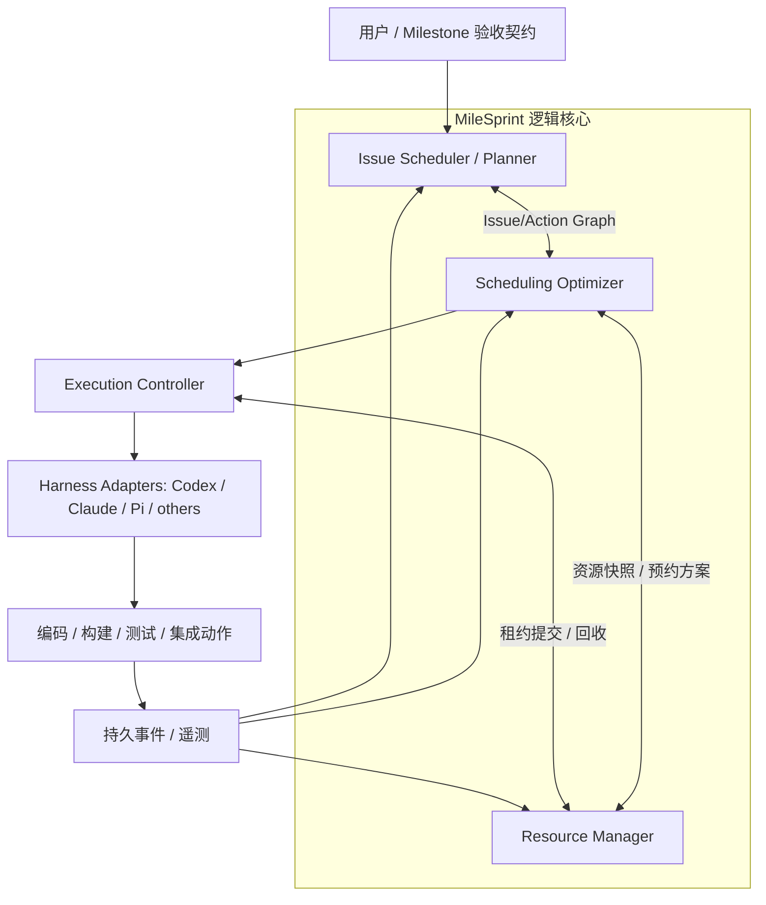
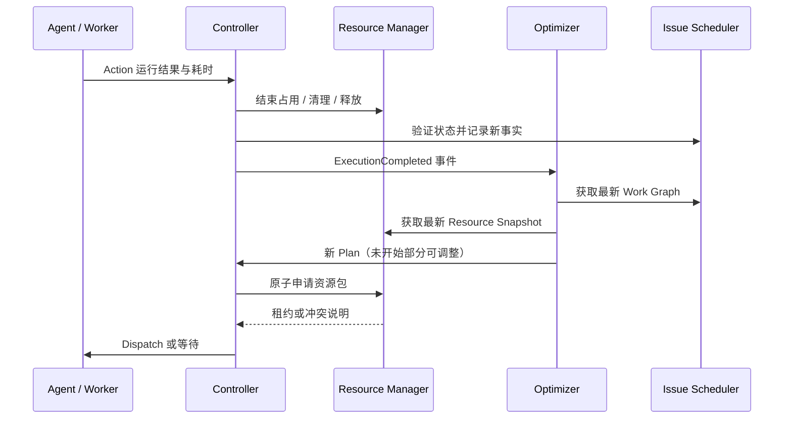

# 06 · 架构、运行时协议与对接形式

## 1. 逻辑架构：三个业务核心 + 运行机制



- **Issue Scheduler / Planner**：维护事务状态、动态依赖、Action 切分及必要的人类澄清。
- **Resource Manager**：维护注册资源的真实状态、能力/安全约束与安全占用。
- **Scheduling Optimizer**：最短交付时间的全局排程、耗时学习与滚动重规划。
- **Execution Controller**：在已有资源承诺下执行或恢复 Action；不另行定义全局业务调度目标。
- **Event Store**：使状态能从 Agent Session 崩溃和上下文变化中恢复。

LLM 擅长语义分析、推理未知关系、问题定位和提出行动。确定性组件更适合负责状态变更的事务性、资源租约、并发互斥、幂等性和时间区间约束。

## 2. 接口契约（候选）

### Issue Scheduler 提供

`GetWorkGraph(milestone_id)`：返回 Issue、Action、用户可见状态、执行态、证据化的关系、验收条件及图版本号。  
`ProposeWorkMutation(event)`：提出创建、拆分、重开、关闭、改关系等变更；验证状态机后原子写入。  
`GetHumanQuestions()`：返回可合并的必要澄清或用户裁决问题。

### Resource Manager 提供

`ListResourceCapabilities()`：平台、版本、功能、数据安全、父资源与容量。  
`GetResourceSnapshot()`：容量、健康、预约、租约和快照版本。  
`ReserveResourceBundle(action_run_id, resources, plan_revision)`：对整个资源包原子申请/预约；失败返回具体约束。  
`RenewLease(lease_id, token)` / `ReleaseLease(lease_id, token)`：持有与释放，仅有效代际可操作。  
`ReportResourceHealth(resource_id, evidence)`：状态变更及清理隔离。

### Scheduling Optimizer 提供

`OptimizeSchedule(work_graph_version, resource_snapshot_version, horizon)`：生成符合约束的候选排程、备选资源、关键路径估计和解释。  
`AcceptExecutionEvent(event)`：更新观测与重规划触发条件。  
`GetCurrentPlan(milestone_id)`：提供当前计划及与上一版本的差异。

### Controller 提供

`Dispatch(action_id, resource_reservation, plan_revision)`；`Cancel/Retry/Resume(action_run_id)`；`ReportExecutionEvent(event)`。每次运行分配唯一 `action_run_id` 与幂等键，防止重启后重复派发并产生不可逆副作用。

## 3. 关键数据对象（概念稿）

```text
Milestone(id, scope, acceptance_contract, state)
Issue(id, milestone_id, kind, visible_state, acceptance_criteria)
Action(id, issue_id, type, execution_state, resource_demand, duration_estimate)
Edge(from, to, type, evidence, confidence, last_verified_at)
Resource(id, kind, capabilities, parent_id, capacity, security_policy, health)
Lease(id, resource_id, action_run_id, fencing_token, expires_at, generation)
ExecutionRun(id, action_id, plan_revision, started_at, ended_at, outcome)
Observation(run_id, queue_wait, setup, execution, cleanup, resource_usage)
Verification(id, target, revision, scope, result, invalidated_by)
SchedulePlan(id, based_on_versions, horizon, assignments, forecast, generated_at)
Event(id, type, aggregate_id, timestamp, payload, idempotency_key)
```

使用 SQLite + 事件日志是初步候选，尚未定案。需要提供事务提交、快照版本校验和进程异常恢复；不得将单个 LLM 对话视为唯一可信状态。

## 4. 事件驱动的工作协议



事件至少包括：`IssueCreated`、`IssueChanged`、`DependencyDiscovered`、`ClarificationReceived`、`ActionStarted/Completed/Failed`、`LeaseExpired`、`ResourceAvailable/Unhealthy`、`VerificationInvalidated`、`IntegrationFailed/Passed`、`AcceptanceApproved/Rejected`。对重放和重复消费需有明确幂等策略。

## 5. Skill、MCP、独立工具的选择仍未定

| 形态 | 用途 | 已识别边界 |
|---|---|---|
| Skill / Agent 规则 | 引导 Agent 调用 MileSprint、汇报证据、澄清需求 | 单靠 Prompt 不易保证资源锁、进程恢复、持久一致性 |
| MCP Server | 暴露 Issue/Resource/Plan 工具供多 Harness 使用 | MCP 是接口协议，不自动提供调度算法和长期控制循环 |
| CLI / TUI | 用户启动、查看计划、操作资源注册和审批 | 需要底层可恢复的持久 Runtime |
| 独立本地 Runtime（倾向） | 实现事件循环、排程、租约、状态与执行适配 | 初始工程复杂度更高 |

**当前倾向但非最终决策**：先确保核心调度内核可以独立运行，再提供 CLI + MCP + Skill 多种入口；不强绑定某种 Coding Harness。要避免过早重造已有的 Agent 进程执行机制。

## 6. 单机代码隔离策略

并行调查默认优先，写入并发根据隔离与冲突证据开放；受控代码集成可串行或批量执行。Git worktree 可提供工作目录隔离，但不解决业务冲突。仓库如果禁止新分支，不能擅自创建分支；分支、提交、文件删除、不可逆数据库操作应遵守当前项目的显式策略。

## 7. 故障恢复不变量

- 被优化器选中不等于已经获得资源；只有 Resource Manager 成功原子提交租约才可以执行。
- 过期或丢失租约的 Worker 不得继续有效修改受保护资源。
- 事件日志可重放，重复事件不会导致重复执行不可幂等动作。
- 计划版本失效时，未开始的派发应重新校验，而非盲目执行陈旧计划。
- 不能因为 Worker 汇报“完成”就自动绕过 Issue 完成标准和必要测试证据。
