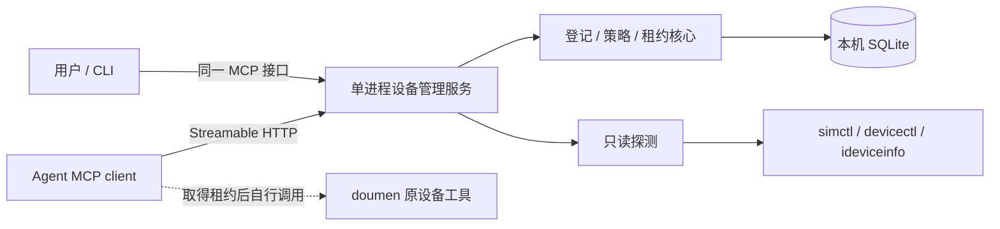

# v0.0.1 设备管理器：技术设计与实施计划

- 状态：设计已成稿；代码未开始，当前仅交付设计。
- Product Authority: [prd.md#confirmed-product-decisions](prd.md#confirmed-product-decisions)
- Applicable Decisions: PD1, PD2, PD3, PD4, PD5
- Plan Authoring: blocked-on-user-decision
- Plan validity: valid-with-qualifications
- Execution Tracking: not-started
- 下述 Python、存储、接口和默认值是实现建议，不是新增用户授权。

## Execution Contract

- Product Authority Source 中 active 的用户确认决策是产品权威；修改需用户明确批准，禁止 Agent 自行批准。
- 工程证据可以修改本计划，不能静默改写产品权威；新产品选择需延期、局部暂定或经用户确认。
- 每个实质阶段开始前，对已完成实现与全部剩余设计、单元、依赖、验证和顺序执行 Pre-Phase Plan Rebase。
- gate 为 pending 或 blocked-on-plan-approval 时不得开始该阶段；material Plan Delta 必须记录并获得具体批准后才能应用和继续实施。
- 每个阶段结束只审计该阶段的 Product Decision Delta；未解决的 material provisional/conflict 阻止依赖工作继续。
- 每阶段新增手写生产代码不得超过 500 行，单个手写源文件不得超过 500 行；超出预计先收缩设计并申请批准，不以拆文件规避阶段上限。
- 测试仅针对本主题；本计划不授权启动、安装、测试、清理或新建设备，也不改变 doumen 仓库。

## 1. 当前事实与最小方案

本仓库只有概念文档，无代码、依赖清单或测试框架。当前 Mac 已有 Python 3.13、uv、完整 Xcode、ideviceinfo；只读设备和磁盘采集已经验证。doumen 设备登记声明和现有 monitor 不具备全机租约功能。证据见 [evidence.md](evidence.md)。

建议一套 Python 包、一个常驻进程、一份本机 SQLite；只依赖官方 MCP SDK 和其必要依赖，其他使用标准库。不加入 Web 前端、Redis、任务队列、ORM、插件框架或事件溯源系统。

服务不持有启动/安装/清理子进程，不提供任意命令、脚本执行或 `lease exec` 包装器。MCP 会话结束不等于设备工作结束，租约独立持久化。

## 2. 进程与接口

- `milesprint serve`：前台启动，监听 `127.0.0.1:<可配置端口>/mcp`；CLI 不隐式启动第二个管理实例。
- `milesprint devices ...` / `milesprint lease ...`：CLI 通过 SDK 调用相同工具；`--json` 提供结构化输出。不复制 REST 业务 API。
- 首版只交付 Streamable HTTP；不同时实现 stdio 桥。前者适合多个 Agent 连接一个独立进程，见 [官方协议](https://modelcontextprotocol.io/specification/2025-11-25/basic/transports)。
- 普通 Agent 凭据允许查询与租约；建议操作者凭据用于登记、策略修改、恢复。仍处于同一用户信任域，不宣称抵抗可读取本地凭据的 Agent。
- 使用 SDK 的 Host/Origin 校验及本地 bearer 凭据；不监听局域网，不实现 OAuth 平台。凭据与数据库存于用户级本地状态目录，不随 worktree 克隆，不提交仓库。
- 单实例以同一状态目录的进程锁约束；第二实例必须报错退出。SQLite 事务仍负责跨调用并发一致性。
- 自动登录启动项和 stdio 兼容桥不进入第一版；先手动运行一个服务，避免额外守护安装与生命周期逻辑。

### 工具与 CLI 对应（建议契约）

| MCP tool | CLI | 核心输入/结果 |
| --- | --- | --- |
| `manager_status` | `status` | 服务、provider、宿主机概况、观测新鲜度 |
| `devices_list` | `devices list` | 登记设备/候选、筛选；refresh 可请求一次有界刷新 |
| `device_get` | `devices show <alias>` | 状态、typed IDs、资源、策略、持有者；不返回他人 token |
| `device_policy_check` | `devices check <alias>` | bundle、operation、data_scope、receipt 引用 → allow/deny/reason；注明判定基于申报、外部内容仍需核验 |
| `lease_acquire` | `lease acquire <alias>` | 明确设备、holder/task/worktree/branch/SHA、intent、TTL → lease/token 或冲突 |
| `lease_renew` | `lease renew <id>` | lease/token/TTL → 新到期时间 |
| `lease_release` | `lease release <id>` | lease/token、外部工作已结束的声明、交接摘要 |
| `leases_list` | `lease list` | 当前及待恢复占用，不返回 token |
| `device_register` | `devices register` | 操作者：从候选建立/更新别名、用途、启用状态及核验标识 |
| `device_policy_set` | `devices policy set` | 操作者：设备上限及明确 App 授权；占用中拒绝更改 |
| `device_recover` | `devices recover` | 操作者：原因、旧工作已停止的确认，解除待恢复状态 |

所有例子是拟议命令，尚不可运行。devices_list/get 不取得租约；policy_check 也不预留资源。真正 acquire 必须在事务内再次检查策略与占用，避免检查后状态变化。

`lease_acquire` 只按明确设备 ID/别名申请，不自动选其他设备，不设置队列，不引入排程算法。容量下限可作为明确请求条件；未要求的指标缺失只报告，不加入拍脑袋的全局阈值。

## 3. 持久数据与不变量

| 对象 | 最少字段/约束 |
| --- | --- |
| Device | 内部 ID、唯一 alias、kind、typed locators、来源/核验时间、用户能力标签、enabled、policy/revision |
| Observation | device ID、分项 values/status/source/observed_at、provider/schema version、last error；仅保存当前快照 |
| Lease | ID、device ID、token hash、holder/context、声明 intent、policy revision、取得/续租/到期时间、host boot ID、终态与交接摘要 |
| Audit | 时间、事件类型、对象、actor、reason、request ID；无原始 token 和业务正文 |

SQLite 保存结构化当前状态和少量必要审计，不建设完整 Event Store。设备占用从 Lease 推导，不再复制一套可独立漂移的 locked 字段。

关键不变量：

1. 对 held/recovery_required 的 lease 建立每 device 唯一的部分索引；acquire 先处理过期，再以写事务检查并插入。
2. token 是不透明随机能力凭据，只将 hash 存库；续租/释放校验 lease、token 和当前状态。它只防止管理 API 的旧持有者变更新租约，不是物理设备 fencing。
3. 重复释放同一已释放 lease 可返回终态，不改变后来 lease；重复 acquire 返回冲突，凭据丢失由操作者恢复，不新增幂等事务框架。
4. 所有 mutation 由一个服务写入；CLI 不直接写库。身份映射或策略在占用中不可修改，普通元数据展示不冒充权限提升。
5. 服务重启不清锁；有效 lease 从库恢复。到期/host 重启/时间异常依 PRD 待确认规则处理，不因 PID 不存在就直接授予新任务。
6. provider 刷新在事务外进行，过期观察不能伪装为当前就绪；获得 lease 仍不保证后续外部操作成功。

审计只记录登记/策略/租约变更、拒绝、健康状态变化；正常轮询不逐次落日志。首版保留本地审计文件，不主动删除或上传数据；保留期治理留待实测规模需要。

## 4. 只读探测与资源口径

| 路径 | 首版做法 | 明确限制 |
| --- | --- | --- |
| Simulator | `simctl list devices --json`，读取 runtime、UDID、boot、availability、dataPathSize | 不 boot/create/erase；dataPathSize 不是可分配内存 |
| USB 真机 | `devicectl list devices --json-output -`，解析 properties 并保留连接/配对/类型 | 列表也包含模拟器和缓存真机，必须归一化去重；不将 exit 0 视为所有动作就绪 |
| 标识映射 | 从同一观察的 hardware UDID/CoreDevice identifier 建立 typed mapping | 无法核验的历史/手填映射标为 unknown，不按名字配对 |
| 真机空间 | 有界调用 `ideviceinfo ... AmountDataAvailable` | 工具缺失或读取失败记 unknown；不接管 doumen 1Hz guard |
| 宿主机 | 物理内存、逻辑 CPU、模拟器数据盘可用空间；必要时附系统内存压力快照 | 所有模拟器共享；不宣称每模拟器独立 CPU/RAM 余量或实行配额 |

建议后台每 15 秒枚举一次，磁盘每 60 秒采一次，手动 refresh 可提前采集；每条命令设超时，禁止轮询重叠。这里只是初始工程参数，实施时按实际开销调整，不承诺实时 SLA。

acquire 若需当前可达性且观察超过 15 秒，先做有界刷新；失败则给出不可判定原因。USB 安装/运行用途拒绝 paired_only/非 wired；关机可用模拟器允许为外部启动取得租约并返回 needs_boot。

资源指标逐项携带 status/source/observed_at。任何要求容量下限的申请都必须检查值与新鲜度，不能用旧值通过。电量、温度、App 内存和性能基线暂不纳入必达采集。

## 5. doumen 接入方式

1. 服务扫描后由用户核对实际设备与已有 worktree 配置，登记明确别名；不把历史保留名单自动导入为可用。
2. Agent 在安装/测试前 acquire；将返回的 `simulator_udid` 或核验后的 `xcode_destination_id/coredevice_identifier` 显式传给原命令。
3. 原安装脚本继续负责签名、版本、防降级和本地测试 receipt，原测试系统继续负责 fixture/Cloud scope/容量 guard。
4. Agent 显式续租并在操作结束后 release；人工验收继续占用时交接给 human holder，不伪称释放后无人使用。
5. 首次只做管理接口和只读探测演练，不改 doumen 脚本、不自动跑项目测试。实际安装/测试接入属于另行批准的验证动作。

旧工具没有读取 lease 时无法自动遵守约束。因此本版交付同时包括一页 Agent 使用约定，而不是在本仓库重写 doumen 部署器或注入 shell 拦截器。

## Pending Product Decisions

| ID | 决策面 | 当前建议 | 为何重要/证据 | 改变后的影响 |
| --- | --- | --- | --- | --- |
| Q1 | 租约过期与恢复 | recovery_required，操作者确认旧工作结束才解锁 | 外部工作不受服务控制；不能证明 TTL 到期就安全 | 改自动回收会降低无人值守阻塞，也可能产生双重实际使用 |
| Q2 | 具体数据分档与初始授权 | PRD 第 6 节的设备上限 + App preserve/owned_only/resettable | PD5 只确认粒度，未批准具体操作集合 | 改动会影响 policy schema、错误语义与验收；实际设备需逐项登记 |
| Q3 | 管理入口授权方式 | 同一接口、不同逻辑凭据；普通 Agent 不得调策略/恢复入口 | 防误用需要明确边界，同用户不具备强隔离 | 若需要抵抗同用户绕过，则不属于当前最轻量的管理模型 |

## 6. 实施前的最小验证

| ID | 假设/解锁目标 | 最便宜方法与足够证据 | 预算/隔离与停止点 | 当前状态 |
| --- | --- | --- | --- | --- |
| V1 | Apple 工具能提供目录、连接与基本空间 | 本机只读 JSON 和 USB 存储查询成功；不证明可安装/运行 | 本次调查已完成，不做设备变更 | direction-supported |
| V2 | 一个官方 SDK 进程可支持 CLI/MCP 与逻辑凭据 | 阶段 C 前锁定 SDK 版本；对临时库验证 tools/list/call 和拒绝无权限管理调用 | ≤1 个隔离小样，不接真机；不引入自研协议 | planned |
| V3 | 并发/重启不产生双租约 | 临时 SQLite、两个客户端和可控时钟；覆盖唯一索引/过期/旧 token | 仅本主题测试；不占现场设备 | planned |

## 7. 工作单元与阶段

建议三个自然交付阶段，均为 not-started；每阶段先批准具体实现范围，生产代码目标不超过 500 行。若预算无法满足正确性，停下收缩或请求调整，不删减关键不变量凑行数。

### 阶段 A：只读设备目录

#### Pre-Phase Plan Rebase Gate

- Rebase scope: 当前零实现、真实工具 schema、剩余全部计划。
- Material plan delta: pending；Plan delta record: pending。
- User approval: pending-if-material；Gate status: pending。

| 单元 | 位置 / 对象 / 动作 | 结果与 Benefit | Side Effects | 精确验证 / 安全停止 |
| --- | --- | --- | --- | --- |
| A1 | 拟新增 src/milesprint/probes.py：实现有界 Apple JSON/USB 空间只读采集 | 得到有来源的真实设备快照，避免 GUI 与表格解析 | Complexity：一个适配模块与 subprocess 超时；Reach/cost：仅本机轻量元数据请求 | 匿名 JSON fixture + 本主题只读 smoke；解析不兼容即停，不改设备 |
| A2 | src/milesprint/registry.py、store.py：归一化身份、候选登记和 observations 表 | 去重且保留 unknown，避免同机多把锁的前置身份错误 | Complexity：SQLite 与稳定 ID；Reach/cost：新本地状态目录，原项目不变 | 同名/重复来源/缺字段/陈旧 ID fixture；临时库可整体隔离保留，正式库不做删除回滚 |

阶段出口：目录 runtime-verified；仅审计目录/身份语义是否覆盖 PD3 或引入新 material 选择。未完成前不扩入租约实现。

### 阶段 B：策略与独占占用

#### Pre-Phase Plan Rebase Gate

- Rebase scope: 阶段 A 实际对象/身份与全部剩余策略、接口、验证。
- Material plan delta: pending；Plan delta record: pending。
- User approval: pending-if-material；Gate status: pending。

| 单元 | 位置 / 对象 / 动作 | 结果与 Benefit | Side Effects | 精确验证 / 安全停止 |
| --- | --- | --- | --- | --- |
| B1 | src/milesprint/policy.py：按获批 Q2 实现设备上限和 App intent 判定 | 把 PD5 变成可解释的允许/拒绝 | Complexity：有限操作集合与策略 revision；Reach/cost：首次需用户配置设备授权 | preserve/owned_only/越界/未知 scope 表驱动用例；不修改真实设备策略 |
| B2 | src/milesprint/leases.py、store.py：按获批 Q1 实现事务持有、续租、释放和恢复 | 避免遵守协议的 Agent 双重取得同设备 | Complexity：lease/audit 表、token、恢复状态；Reach/cost：接入者需续租及交接 | V3 并发、旧 token、重启/时间异常测试；到期或异常保留记录，不抢占设备 |

阶段出口：核心在临时库 verified；逐项审计新增租约/策略语义。Q1/Q2 未确认则本阶段不开始。

### 阶段 C：服务、CLI 与 Agent 工具闭环

#### Pre-Phase Plan Rebase Gate

- Rebase scope: A/B 实际核心、SDK V2 结果及全部剩余 API/验证/接入。
- Material plan delta: pending；Plan delta record: pending。
- User approval: pending-if-material；Gate status: pending。

| 单元 | 位置 / 对象 / 动作 | 结果与 Benefit | Side Effects | 精确验证 / 安全停止 |
| --- | --- | --- | --- | --- |
| C1 | src/milesprint/server.py、cli.py、pyproject.toml：接 SDK、单实例、本地凭据和同源工具调用 | 多 Agent 与用户共用核心，避免入口行为分叉 | Complexity：SDK 依赖、两个薄入口；Reach/cost：一个本地进程/端口与状态目录 | V2 + CLI/MCP 同设备并发、重启和普通凭据越权拒绝；先用临时库/端口 |
| C2 | runbooks/device-manager.md：给 doumen 写只读接入和 lease 使用约定 | 现有工具能按协议使用明确设备，不重写部署器 | Complexity：一页说明；Reach/cost：Agent 需先申请再执行，旧脚本仍可绕过 | 获准空闲设备上仅管理 lease 演练；不启动安装测试；停止服务后保留原库 |

阶段出口：仅本版本范围闭环 runtime-verified，交用户验收；不以本主题测试证明 doumen 产品回归通过。

## 8. Product Decision Delta 与 Plan Delta

| Phase | Decision Surface | Implemented / Observed Semantics | Authority Coverage | Classification | Required Action |
| --- | --- | --- | --- | --- | --- |
| 设计调查 | 只读现状 | 设备元数据与 doumen 流程证据，无产品实现 | PD1–PD5 仅作为设计约束 | engineering-only | 保持 Draft，先确认 Q1–Q3 |
| A / B / C | 尚未开始 | 无 | 待各阶段核查 | 未审计 | 每阶段结束填写该阶段实际 delta |

当前无已批准实施计划的 material 变更历史。后续变更记录必须包含 previous plan、current fact、proposed change、impact、具体 user approval；不得用“继续”或 Agent 自评代替批准。
