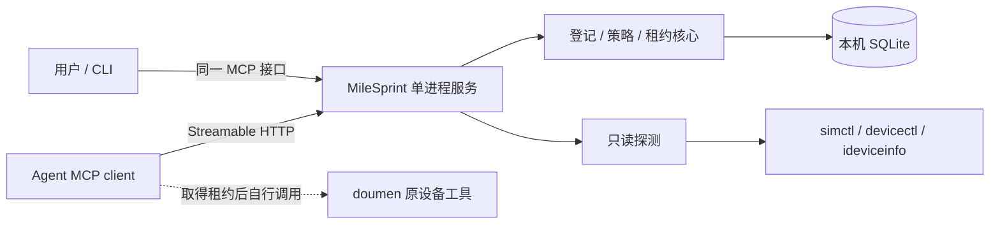

# MileSprint v0.0.1：技术设计与实施计划

- 状态：产品设计与实施前调研已成稿；正式代码未开始。
- Product Authority: [prd.md#confirmed-product-decisions](prd.md#confirmed-product-decisions)
- Applicable Decisions: PD1, PD2, PD3, PD4, PD5, PD6, PD7, PD8, PD9
- Plan Authoring: planned
- Plan validity: valid-with-qualifications
- Execution Tracking: not-started
- Python、存储和接口细节是实现建议；自动到期、默认 resettable、Agent 全管理能力以 PD6–PD8 为准。产品澄清完成不等于已开始或批准代码实施。
- 产品/服务身份固定为 MileSprint（PD9），设备管理是本版能力切片；接口细化见 [contracts.md](contracts.md)。

## Execution Contract

- Product Authority Source 中 active 的用户确认决策是产品权威；修改需用户明确批准，禁止 Agent 自行批准。
- 工程证据可以修改本计划，不能静默改写产品权威；新产品选择需延期、局部暂定或经用户确认。
- 每个实质阶段开始前，对已完成实现与全部剩余设计、单元、依赖、验证和顺序执行 Pre-Phase Plan Rebase。
- gate 为 pending 或 blocked-on-plan-approval 时不得开始该阶段；material Plan Delta 必须记录并获得具体批准后才能应用和继续实施。
- 每个阶段结束只审计该阶段的 Product Decision Delta；未解决的 material provisional/conflict 阻止依赖工作继续。
- 每阶段新增手写生产代码不得超过 500 行，单个手写源文件不得超过 500 行；超出预计先收缩设计并申请批准，不以拆文件规避阶段上限。
- 测试仅针对本主题；本计划不授权启动、安装、测试、清理或新建设备，也不改变 doumen 仓库。

## 1. 当前事实与最小方案

本仓库只有设计与调研材料，无正式源码、依赖清单或测试框架。本轮复核两台 USB 真机、已运行的 DeviceHub 和现有模拟器；Python/MCP 双客户端及 SQLite 租约已经在临时目录做有界小样，未接管设备。doumen 设备登记声明和现有 monitor 不具备全机租约功能。证据与局限见 [evidence.md](evidence.md)。

建议一套 milesprint Python 包、一个名为 MileSprint 的常驻服务、一份本机 SQLite；锁定已验证的官方 mcp==2.3.0，CLI 用 argparse/asyncio 和同一 SDK Client，无需 mcp[cli]/Typer。SDK 仍有约 28 个传递依赖，不能称为零依赖；本轮合成样本空闲 RSS 约 66.8MiB。其余业务使用标准库，不加入 Web 前端、Redis、任务队列、ORM、插件框架或事件溯源系统。

服务不持有启动/安装/清理子进程，不提供任意命令、脚本执行或 `lease exec` 包装器。MCP 会话结束不等于设备工作结束，租约独立持久化。

## 2. 进程与接口

- `milesprint serve`：前台启动，监听 `127.0.0.1:<可配置端口>/mcp`；CLI 不隐式启动第二个管理实例。
- `milesprint devices ...` / `milesprint lease ...`：CLI 通过 SDK 调用相同工具；`--json` 提供结构化输出。不复制 REST 业务 API。
- 首版只交付 Streamable HTTP；不同时实现 stdio 桥。前者适合多个 Agent 连接一个独立进程，见 [官方协议](https://modelcontextprotocol.io/specification/2025-11-25/basic/transports)。
- MCP identity 为 MileSprint，version 为 0.0.1；单接口采用已验证的 stateless_http/json_response，设备和租约依旧持久化。v0.0.1 工具只属于设备管理。
- Agent 与用户 CLI 均可调用全部管理工具，不区分操作者/Agent 角色，不建立工具权限白名单或第二套管理凭据（PD8）。
- 使用 SDK 的 Host/Origin 校验及本地 bearer 凭据；不监听局域网，不实现 OAuth 平台。凭据与数据库存于用户级本地状态目录，不随 worktree 克隆，不提交仓库。
- 2.3.0 可用少量 ASGI 入口逻辑验证静态 token；不配置虚构 issuer。客户端通过 httpx2.AsyncClient 传 header 并设 trust_env=False，不使用已变更的 transport headers 参数。
- 单实例以同一状态目录的进程锁约束；第二实例必须报错退出。SQLite 事务仍负责跨调用并发一致性。
- 自动登录启动项和 stdio 兼容桥不进入第一版；先手动运行一个服务，避免额外守护安装与生命周期逻辑。

### 工具与 CLI 对应（建议契约）

| MCP tool | CLI | 核心输入/结果 |
| --- | --- | --- |
| `milesprint_status` | `status` | MileSprint 身份、设备能力、provider、宿主机概况、观测新鲜度 |
| `devices_list` | `devices list` | 登记设备/候选、筛选；refresh 可请求一次有界刷新 |
| `device_get` | `devices show <alias>` | 状态、typed IDs、资源、策略、持有者；不返回他人 token |
| `device_policy_check` | `devices check <alias>` | bundle、operation、data_scope、receipt 引用 → allow/deny/reason；注明判定基于申报、外部内容仍需核验 |
| `lease_acquire` | `lease acquire <alias>` | 明确设备、holder/task/worktree/branch/SHA、intent、TTL → lease/token 或冲突 |
| `lease_renew` | `lease renew <id>` | lease/token/TTL → 新到期时间 |
| `lease_release` | `lease release <id>` | lease/token、外部工作已结束的声明、交接摘要 |
| `leases_list` | `lease list` | 当前租约与 released/expired 历史，不返回 token |
| `device_register` | `devices register` | 用户或 Agent：从候选建立/更新别名、用途、启用状态及核验标识 |
| `device_policy_set` | `devices policy set` | 用户或 Agent：设备上限及 App 策略；有效租约期间拒绝更改 |

所有例子是拟议命令，尚不可运行。devices_list/get 不取得租约；policy_check 也不预留资源。真正 acquire 必须在事务内再次检查策略与占用，避免检查后状态变化。

`lease_acquire` 只按明确设备 ID/别名申请，不自动选其他设备，不设置队列，不引入排程算法。容量下限可作为明确请求条件；未要求的指标缺失只报告，不加入拍脑袋的全局阈值。

原候选的 device_recover 和 recovery_required 不再需要，直接移除。到期由服务自动处理，不以恢复入口或人工确认阻塞下一份租约。

## 3. 持久数据与不变量

| 对象 | 最少字段/约束 |
| --- | --- |
| Device | 内部 ID、唯一 alias、kind、typed locators、来源/核验时间、能力标签、enabled、policy/revision；App 默认 resettable |
| Observation | device ID、分项 values/status/source/observed_at、provider/schema version、last error；仅保存当前快照 |
| Lease | ID、device ID、token hash、holder/context、声明 intent、policy revision、取得/续租/到期时间、held/released/expired、交接摘要 |
| Audit | 时间、事件类型、对象、actor、reason、request ID；无原始 token 和业务正文 |

SQLite 保存结构化当前状态和少量必要审计，不建设完整 Event Store。设备占用从 Lease 推导，不再复制一套可独立漂移的 locked 字段。

关键不变量：

1. 对 held lease 建立每 device 唯一的部分索引；acquire 先 BEGIN IMMEDIATE，取得锁后读取当前时间，再把到期 lease 标为 expired、检查占用并插入。后台扫描延迟不得阻止到期后重新申请，事务失败整体回滚。
2. token 是不透明随机能力凭据，只将 hash 存库；续租/释放校验 lease、token 和当前状态。它只防止管理 API 的旧持有者变更新租约，不是物理设备 fencing。
3. 重复释放同一 released/expired lease 只返回其终态，不改变后来 lease；有效期内重复 acquire 返回冲突，凭据丢失可等待自动到期，不新增幂等事务或人工恢复框架。
4. 所有 mutation 由一个服务写入；CLI 不直接写库。身份映射或策略在占用中不可修改，普通元数据展示不冒充权限提升。
5. 服务重启按持久化的 expires_at 判断；有效 lease 保留，过期自动结束，不重置 TTL。旧 token 到期后不可 renew，不能操作新 lease；无需确认旧进程停止。
6. provider 刷新在事务外进行，过期观察不能伪装为当前就绪；获得 lease 仍不保证后续外部操作成功。
7. 时限存 UTC epoch 毫秒，monotonic 只做超时/轮询调度。SQLite 写锁等待超时返回 STORE_BUSY；不得冒充设备冲突或空闲。实例 flock 持有 FD 且不删除锁文件。

审计只记录登记/策略/租约变更、拒绝、健康状态变化；正常轮询不逐次落日志。首版保留本地审计文件，不主动删除或上传数据；保留期治理留待实测规模需要。

## 4. 只读探测与资源口径

| 路径 | 首版做法 | 明确限制 |
| --- | --- | --- |
| Simulator | `simctl list devices --json`，读取 runtime、UDID、boot、availability、dataPathSize | 不 boot/create/erase；dataPathSize 不是可分配内存 |
| USB 真机 | devicectl JSON 的 properties + idevice_id USB 清单 | 列表也包含模拟器和缓存真机，必须归一化去重；不将 exit 0 视为所有动作就绪 |
| 标识映射 | 从同一观察的 hardware UDID/CoreDevice identifier 建立 typed mapping | 无法核验的历史/手填映射标为 unknown，不按名字配对 |
| 真机空间 | 有界调用 `ideviceinfo ... AmountDataAvailable` | 工具缺失或读取失败记 unknown；不接管 doumen 1Hz guard |
| 电量/充电 | 可选读取已验证的 mobile.battery 域 | 轻量展示，不作为默认申请硬条件，不引入性能采样 |
| 宿主机 | 物理内存、逻辑 CPU、模拟器数据盘可用空间；必要时附系统内存压力快照 | 所有模拟器共享；不宣称每模拟器独立 CPU/RAM 余量或实行配额 |

建议后台每 15 秒枚举一次，磁盘每 60 秒采一次，手动 refresh 合并到已有探测；禁止同设备同类轮询重叠。simctl/USB 枚举/Apple 快速目录本轮均约 5–116ms，支持该方向，但不承诺 SLA。

详情/锁状态按需查询，不能进入每轮快速目录：iPhone connected 时 details 仍在 5 秒截止处 timeout。devicectl 参数 timeout 最低 5 秒，配外层截止；ideviceinfo 不用 -s，校验非空字段，避免 exit 0 的空 plist 被当作资源值。

acquire 若需当前可达性且观察超过 15 秒，先做有界刷新；失败则给出不可判定原因。USB 安装/运行用途拒绝 paired_only/非 wired；关机可用模拟器允许为外部启动取得租约并返回 needs_boot。

资源指标逐项携带 status/source/observed_at。任何要求容量下限的申请都必须检查值与新鲜度，不能用旧值通过。温度、App 内存和性能基线不纳入首版；电量仅为可选项。模拟器数据卷按文件系统去重，不累计为每台独立容量。

## 5. doumen 接入方式

1. 服务扫描后用户或 Agent 核对实际设备与已有 worktree 配置，登记明确别名和设备上限；未单独指定 App 策略时用 resettable，不要求额外人工批准。
2. Agent 在安装/测试前 acquire；将返回的 `simulator_udid` 或核验后的 `xcode_destination_id/coredevice_identifier` 显式传给原命令。
3. 原安装脚本继续负责签名、版本、防降级和本地测试 receipt，原测试系统继续负责 fixture/Cloud scope/容量 guard。
4. Agent 显式续租并在操作结束后 release；人工验收继续占用时交接给 human holder 并维持租约。任何 holder 到期都自动结束占用，不额外保护人工现场。
5. 首次只做管理接口和只读探测演练，不改 doumen 脚本、不自动跑项目测试。实际安装/测试接入属于另行批准的验证动作。

旧工具没有读取 lease 时无法自动遵守约束。因此本版交付同时包括一页 Agent 使用约定，而不是在本仓库重写 doumen 部署器或注入 shell 拦截器。

## Pending Product Decisions

无阻塞产品未决项；原 Q1–Q3 已由用户直接确认，权威记录保存在 PRD，不在本计划维护第二套决策。

| 原问题 | 权威引用 | 对剩余实现的影响 |
| --- | --- | --- |
| Q1 到期处理 | PD6 | 自动 expired/解除占用，删除待恢复状态与恢复工具 |
| Q2 数据分档与默认 | PD5、PD7 | 保留三档，目标 App 缺省 resettable；不按设备类型默认 preserve |
| Q3 管理入口 | PD8 | Agent 可登记、改策略和操作租约；不做角色鉴权和操作者专用入口 |

## 6. 实施前的最小验证

| ID | 假设/解锁目标 | 最便宜方法与足够证据 | 预算/隔离与停止点 | 当前状态 |
| --- | --- | --- | --- | --- |
| V1 | Apple 工具能提供目录、连接与基本空间 | 两台 USB 的枚举/存储/电量成功，发现 details 超时与空返回陷阱；不证明可安装/运行 | 只读现场复核完成，未拔插/启停设备 | direction-supported |
| V2 | 一个官方 SDK 进程可支持 CLI/MCP 与本地连接认证 | mcp==2.3.0 两个客户端共享合成状态，CLI、本地入口保护、结构化错误均已验证 | 小样只在临时目录，服务已停止；不接真机 | direction-supported |
| V3 | 并发/重开数据库不产生双租约 | 20 轮双进程竞争、到期、旧 token、回滚、关库重开、flock 已通过 | 可控时钟与临时 SQLite，不证明成品服务重启或异常断电 | direction-supported |

V1–V3 是独立的投资前验证，不等于开始阶段 A/B/C。结构化结果与未证明事项见 [evidence.md](evidence.md)。

## 7. 工作单元与阶段

建议三个自然交付阶段，均为 not-started；每阶段先批准具体实现范围，生产代码目标不超过 500 行。若预算无法满足正确性，停下收缩或请求调整，不删减关键不变量凑行数。

### 阶段 A：只读设备目录

#### Pre-Phase Plan Rebase Gate

- Rebase scope: 当前零实现、真实工具 schema、剩余全部计划。
- Material plan delta: pending；Plan delta record: pending。
- User approval: pending-if-material；Gate status: pending。

| 单元 | 位置 / 对象 / 动作 | 结果与 Benefit | Side Effects | 精确验证 / 安全停止 |
| --- | --- | --- | --- | --- |
| A1 | 拟新增 src/milesprint/probes.py：按 contracts 实现快速目录、按需详情与有界 USB 资源采集 | 单台慢查询不阻塞目录，字段/错误可解释 | Complexity：一个适配模块与分项超时；Reach/cost：仅本机轻量元数据请求 | 匿名 JSON/plist fixture 覆盖 timeout/exit0空值/同名/重复来源 + 两台只读 smoke；解析不兼容即停，不改设备 |
| A2 | src/milesprint/registry.py、store.py：归一化身份、候选登记和 observations 表 | 去重且保留 unknown，避免同机多把锁的前置身份错误 | Complexity：SQLite 与稳定 ID；Reach/cost：新本地状态目录，原项目不变 | 同名/重复来源/缺字段/陈旧 ID fixture；临时库可整体隔离保留，正式库不做删除回滚 |

阶段出口：目录 runtime-verified；仅审计目录/身份语义是否覆盖 PD3 或引入新 material 选择。未完成前不扩入租约实现。

### 阶段 B：策略与独占占用

#### Pre-Phase Plan Rebase Gate

- Rebase scope: 阶段 A 实际对象/身份与全部剩余策略、接口、验证。
- Material plan delta: pending；Plan delta record: pending。
- User approval: pending-if-material；Gate status: pending。

| 单元 | 位置 / 对象 / 动作 | 结果与 Benefit | Side Effects | 精确验证 / 安全停止 |
| --- | --- | --- | --- | --- |
| B1 | src/milesprint/policy.py：按 PD5/PD7 实现设备上限、App 三档及缺省 resettable | 可解释判定，默认不增加现场保护负担 | Complexity：有限操作集合与策略 revision；Reach/cost：用户或 Agent 可配置保护例外 | 缺省 resettable、显式 preserve/owned_only、越界/未知 scope 表驱动用例；不改变真实设备 |
| B2 | src/milesprint/leases.py、store.py：按 PD6 实现事务持有、续租、释放和自动到期 | 有效期互斥，到期后立即可重新申请 | Complexity：lease/audit 表与 token，取消恢复状态；Reach/cost：接入者需续租，旧任务可能继续执行 | V3 并发、到期即时重分配、旧 token、重启保留期限测试；保留记录，不杀设备进程 |

阶段出口：核心在临时库 verified；逐项审计新增租约/策略语义是否覆盖 PD5–PD7，不重新询问已确认选择。

### 阶段 C：服务、CLI 与 Agent 工具闭环

#### Pre-Phase Plan Rebase Gate

- Rebase scope: A/B 实际核心、SDK V2 结果及全部剩余 API/验证/接入。
- Material plan delta: pending；Plan delta record: pending。
- User approval: pending-if-material；Gate status: pending。

| 单元 | 位置 / 对象 / 动作 | 结果与 Benefit | Side Effects | 精确验证 / 安全停止 |
| --- | --- | --- | --- | --- |
| C1 | src/milesprint/server.py、cli.py、pyproject.toml：接固定 SDK、MileSprint 身份、单实例、入口凭据和 typed result | 多 Agent 与用户共用全部设备管理能力，错误无需文本解析 | Complexity：SDK 依赖、薄入口与一个结构化错误 helper，不做角色分层；Reach/cost：一个本地进程/端口与状态目录 | V2 已支持方向；正式实现补 HTTP/SQLite 联动、重启、真实目录和身份/工具集合断言；先用临时库/端口 |
| C2 | runbooks/device-manager.md：给 doumen 写只读接入和 lease 使用约定 | 现有工具能按协议使用明确设备，不重写部署器 | Complexity：一页说明；Reach/cost：Agent 需先申请再执行，旧脚本仍可绕过 | 获准空闲设备上仅管理 lease 演练；不启动安装测试；停止服务后保留原库 |

阶段出口：仅本版本范围闭环 runtime-verified，交用户验收；不以本主题测试证明 doumen 产品回归通过。

## 8. Product Decision Delta 与 Plan Delta

| Phase | Decision Surface | Implemented / Observed Semantics | Authority Coverage | Classification | Required Action |
| --- | --- | --- | --- | --- | --- |
| 设计调查 | 只读现状 | 设备元数据与 doumen 流程证据，无产品实现 | PD1–PD5 仅作为设计约束 | engineering-only | 调查完成 |
| 设计澄清 | 到期、默认保护、管理权限 | 已按用户回答更新设计，无代码实现 | PD6–PD8 | covered | 剩余实施前按本计划执行阶段 rebase |
| 实施前调研 | MileSprint 身份与版本能力；只读现场/隔离小样 | 产品命名已确认，工程可行性有证据；无正式实现 | PD9；其余为 engineering-only | covered | 接口细化为工程草案，正式实施 gate 仍 pending |
| A / B / C | 尚未开始 | 无 | 待各阶段核查 | 未审计 | 每阶段结束填写该阶段实际 delta |

本次设计变更已获用户对具体产品选择的直接确认；它不是代码实施授权。后续 material 计划变更仍需记录具体事实与批准。

| ID | Before Phase | Previous Plan | Current Fact | Proposed Change | Impact | User Approval | Status |
| --- | --- | --- | --- | --- | --- | --- | --- |
| DD1 | B/C，均未开始 | 到期待人工恢复；默认保留数据；操作者与 Agent 分权 | 用户明确选择自动释放、最低保护默认和 Agent 全管理能力 | 按 PD6–PD8 更新 lease、policy、工具与验证，移除恢复状态/入口和角色分层 | 降低现场保护与人工恢复负担；接受旧任务冲突；减少实现概念 | user-approved-plan-direct: 2026-10-19 三项具体问答，见 PRD PD6–PD8 | 已应用于设计，未实施 |
| DD2 | A/B/C，均未开始 | 通用技术候选，V2/V3 尚未验证 | 两台 USB、分项查询异常、SDK 2.3.0 与租约小样已有实证；用户明确品牌不变 | 细化 contracts、固定 SDK、快速/慢查询隔离和错误契约；产品身份统一 MileSprint | 提前排除 API/解析/并发假设，未增加代理操作或产品范围 | user-approved-discovery-direct: 2026-10-19「先做正式实施之前的调研」「先细化细节」；正式实施未批准 | 调研/草案已更新，未实施 |
