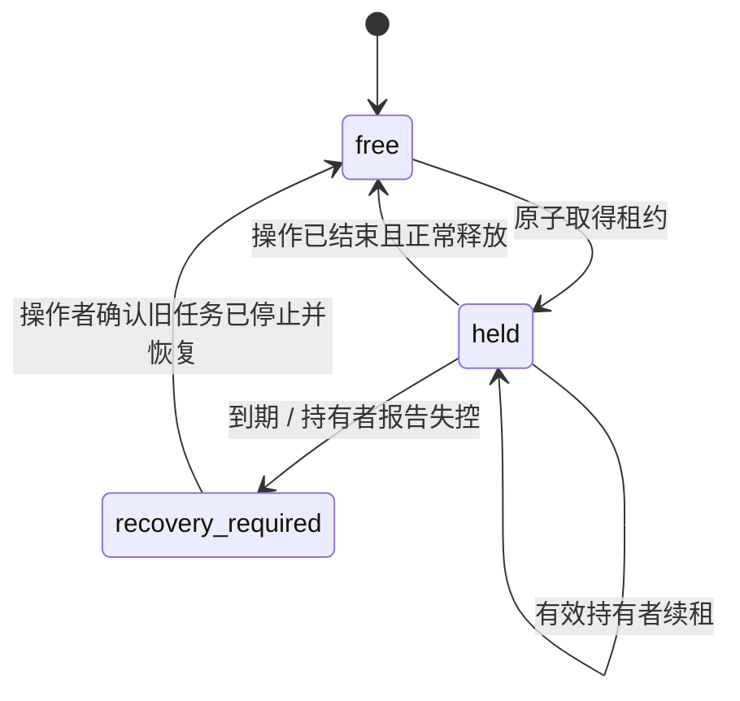

# PRD：v0.0.1 本机设备管理器

- Status: Draft
- Created: 2026-10-19
- Updated: 2026-10-19
- Owner / requester: ceasarXuu
- Source request: 以本机 doumen 为标的，只设计最轻量的无界面设备管理器，为 Agent 提供工具入口。
- Product Authority: 本文 `Confirmed Product Decisions`，仅 active 行具有用户决策效力。

## 请求人审阅摘要

首版解决“有哪些设备、当前能否使用、允许怎样改变数据、由谁持有、何时释放”。实际启动、安装、测试和清理继续使用现有工具。服务只约束登记、策略和租约，不构成操作系统级设备隔离。

已确认：只做设备管理；无界面且尽量轻；面向本机 doumen；不代理设备操作；设备保护上限与 App 单独授权组合。

待确认：租约过期后的回收规则、数据策略的具体分档及实际设备初始授权。本文这些细节均是建议，不代表已经授权。

## 1. 背景与目标

doumen 已有安装、测试、设备容量监控和多 worktree 规范，但设备分配文件只是声明，没有全机统一排他租约。不同 Agent 可能覆盖同一设备上的构建，或把“已配对”误当“可操作”。详见 [调查依据](evidence.md)。

v0.0.1 的目标是让多个协作 Agent 查询同一份设备事实并取得互斥占用，明确数据变更边界。结果必须区分现场观察、人工配置与调用者声明。

成功标准：两个遵守协议的 Agent 争用同一设备时，只有一个取得有效租约；另一方得到持有者和冲突原因。断连、过期、未知数据策略均有明确状态，不自动冒充空闲或获批。

## 2. 用户与场景

- 用户：登记设备、设定数据策略、保留人工验收占用、处理失联租约。
- Agent：查询、申请、续租、释放；使用返回的明确设备 ID 调用 doumen 现有工具。
- doumen 的不同 worktree 共享本机设备管理实例，不各自建立独立锁。

当前实例服务本机一个项目；repo/worktree 是占用上下文，不扩展为多项目调度平台。

## 3. 范围

| 范围内 | 本版不做 |
| --- | --- |
| 发现、登记、停用已有模拟器和 USB 真机 | 新建/删除模拟器、下载 runtime、系统升级、设备配对 |
| 机型、系统、标识映射、用途与能力说明 | 从机型推断真实相机/蓝牙等测试能力 |
| 连接、runtime 可用性、启动状态和观测时间 | 自动启动、解锁、重启、安装、运行或清理设备 |
| 存储空间与共享宿主机资源概况 | CPU/RAM 配额调度、完整性能采样、Instruments 录制 |
| 设备保护上限、App 数据策略、意图检查 | 云账号授权、CloudKit 数据操作、权限提升 |
| 单设备独占 acquire/renew/release、人工占用 | 预约队列、优先级、抢占、原子多设备资源包 |
| 本地服务、CLI、MCP tools | GUI/TUI、远程控制面、Agent/Issue 调度器 |

## 4. 最小使用流程（建议）

1. 用户启动本地服务，扫描现有设备；发现设备先列为候选，不自动取得数据变更授权。
2. 用户为选定设备登记别名、用途、设备保护上限和 App 策略。
3. Agent 查看状态，选定明确设备，申报任务、worktree、操作意图和数据作用域。
4. 服务检查策略、观察新鲜度与占用，在一个事务内授予或拒绝租约。
5. Agent 用返回的 typed identifiers 调用现有设备工具；长任务显式续租。
6. 任务结束后 Agent 确认其设备操作已结束并释放；服务记录交接信息，不自动清理数据。

若用户要保留人工验收现场，可通过同一套租约接口以 human 持有者登记，不另建预约系统。

## 5. 设备信息与状态（建议）

| 信息 | 内容与含义 |
| --- | --- |
| 登记信息 | 稳定内部 ID、别名、类型、用途标签、启用状态 |
| 标识映射 | simulator UDID / hardware UDID / CoreDevice identifier，分别保存来源和核验时间 |
| 基础能力 | 平台、机型、OS/runtime、架构；额外适测能力由用户声明，不伪装成实测 |
| 运行观察 | provider 是否成功、设备连接、USB/其他连接方式、boot 状态、runtime 是否可用 |
| 资源 | 真机可用磁盘、模拟器数据目录大小、宿主机磁盘/内存概况；每项附来源与时间 |
| 占用 | 当前 holder、任务、worktree、branch、source SHA、取得/续租/到期时间 |
| 数据策略 | 设备上限、目标 App 策略、声明意图的允许/拒绝及理由 |

可达性、启动状态和占用分开：

- 关机且 runtime 完整的模拟器显示 `needs_boot`，可为外部启动任务取得租约；不标为失联。
- 缺少 runtime 的模拟器显示 `runtime_unavailable`，拒绝普通使用申请，不自动修复。
- 已配对但当前未连接的真机显示 `paired_only`，不承诺 USB 就绪。
- 锁屏单独描述，不因 Locked 一概判为离线；安装与启动能力可能不同。
- 没有租约只表示“管理器未记录持有者”，不证明外部脚本或人工没有使用。
- 未获得或过期的指标显示 `unknown/unsupported/stale`，不填 0，不借用其他设备的值。

## 6. 数据变更规则（粒度已确认，分档待确认）

这里的等级表达“Agent 可以改变什么”，不是旧概念稿里数据本身有多敏感的 public/internal 分类。

建议采用设备上限和 App 策略两层：设备上限限制最大变更范围；App 授权只能进一步收窄，不能突破设备上限。没有匹配 App 授权时不得自行推导更高权限。

| 层级 | 建议值 | 约束 |
| --- | --- | --- |
| 设备上限 | `app_scoped` | 只允许明确 App 范围内获批的操作，禁止整机擦除、相册/系统数据改动 |
| 设备上限 | `device_resettable` | 仅对用户明确授权的既有模拟器考虑；不是创建/删除设备的授权 |
| App 策略 | `preserve` | 允许保留数据的覆盖安装/正常启动；禁止主动重置、卸载及破坏原业务数据 |
| App 策略 | `owned_only` | 可创建、修改、清理本任务登记的测试数据/隔离测试包，保留原有数据 |
| App 策略 | `resettable` | 可重置明确 App 的本地沙盒；不包含云数据或其他 App |

`preserve` 不声称 App 正常运行完全零写入；业务内容变更仍需对应任务授权。`owned_only` 必须附外部 receipt/对象清单引用，管理器不替代 doumen 的真实性校验和清理器。

建议初始化：真机和普通 doumen App 保留数据；隔离测试包使用 `owned_only`；模拟器也不因其类型自动视为可清空。实际设备逐项配置后才生效，本次设计不写入任何设备授权。

策略查询按“设备 + bundle + operation + data_scope + 外部授权引用”返回结果。未声明、未知作用域或超出上限则拒绝；CloudKit/相册/系统数据变更返回外部授权范围不受本管理器覆盖，不能用设备租约代替授权。通过只表示申报范围符合策略，不表示管理器已经读取并核验 receipt 内容或实际对象归属。

策略只控制管理器是否授予声明用途的租约，不阻止 Agent 绕过服务调用 shell。建议普通 Agent 的 MCP 凭据不得调用策略提升和强制回收入口；同一 macOS 用户仍能通过本地工具绕过，因此不能宣称存在管理员与 Agent 的强隔离。

## 7. 占用、释放与恢复（建议，待确认）

- 独占单位为整台设备，暂不按 App 共享；同设备不同 bundle 仍可能争用安装、界面和测试 runner。
- 续租和释放必须出示对应 lease token；旧 token 不能释放后续持有者的租约。
- 同一 holder 不因重复申请而获得第二份租约；申请结果丢失时先查询，无法恢复凭据则由操作者处理。
- 释放只改变占用记录；不会卸载 App、清数据、关闭模拟器或终止他人进程。
- 建议到期进入 `recovery_required`，不自动重新分配。服务无法证明外部任务已经停止。
- 设备断连不释放已有租约；连接恢复后仍保留原持有关系。过期规则独立适用。
- 同一宿主机启动周期内服务重启保留有效租约；宿主机重启、时间可信度异常时转待恢复。
- 操作者恢复需说明原因并确认外部任务已停止，记录原持有者；服务不负责杀进程。
- 有租约或待恢复的设备不允许修改策略；先完成交接，避免引入动态撤权执行机制。

## 8. 观测与异常

设备注册、策略调整、租约变更、拒绝理由和异常状态变化留本地审计；不逐次记录正常轮询，不收集用户文件、截图、账号或业务正文。token 不进入日志。

工具缺失、命令超时、输出 schema 不兼容、设备标识冲突都返回具体原因。工具返回成功不代表安装/测试已经成功；source SHA 是调用者申报的任务上下文，不是设备安装事实。

新设备、同名设备、陈旧 worktree 设备配置不得自动替换目标。停用设备保留历史记录；本版无需永久删除台账。

## 9. 验收草案

| 场景 | 可观察结果 |
| --- | --- |
| 两个 CLI/MCP 调用者同时申请同一设备 | 仅一个有效租约；另一方获得持有者、到期时间及冲突原因 |
| 两个 doumen worktree 指定同一设备 | 返回同一内部设备，不因路径不同建立两把锁 |
| 同名模拟器、过期 UDID 或不同类型真机 ID | 不按名字猜选、不混用 ID；无法核验时明确拒绝 |
| 模拟器关机 / 缺少 runtime | 分别为 needs_boot / runtime_unavailable；不启动或创建设备 |
| USB 真机拔出、重连、只剩配对缓存 | 状态及时间更新，占用保持；不把配对缓存当就绪 |
| 存储读取失败或样本陈旧 | 标明未知/过期；要求容量下限的申请无法凭旧值通过 |
| preserve App 请求卸载 / owned_only 未提供登记范围引用 | 策略检查和租约申请拒绝；不会替代外部清理器的对象归属核验 |
| 过期、旧 token、服务重启、人工验收占用 | 不出现两个管理器有效持有者；不自动抢占失联任务 |
| 正常释放 | 租约结束，设备数据与运行状态不会被管理器改变 |
| Agent 使用明确 ID 接入 doumen 原工具 | 无需更改 doumen 构建、签名、测试与数据保护门禁 |

验收只使用与设备管理直接相关的合成并发测试和只读现场观察。真实持有/释放演练需在获准使用的空闲设备上进行；不触发 doumen 全量测试、安装或数据清理。

## Confirmed Product Decisions

> PROTECTED USER-AUTHORITY SECTION
> Rows in this section MUST NOT be created, modified, deleted, reinterpreted,
> or superseded without explicit user approval for that specific decision change.
> Agent self-approval is forbidden.

| ID | Confirmed Decision | Must Do | Must Not Do | Rationale | Violation Signal | Confirmation | Status |
| --- | --- | --- | --- | --- | --- | --- | --- |
| PD1 | v0.0.1 只做设备管理器 | 限于设备相关闭环 | 扩入任务调度与优化器 | 首版缩小范围 | 新增 Issue/Agent 调度功能 | user-confirmed-direct: 2026-10-19「只做设备管理器」 | active |
| PD2 | 最轻量、无界面，向 Agent 提供工具入口 | 设计 CLI/MCP 可接入的轻量形态 | 建设 GUI | 用户明确交付方向 | 首版需要操作管理界面 | user-confirmed-direct: 2026-10-19「最轻量的无界面的形式」「以 mcp/tools 方式向 agent 提供」 | active |
| PD3 | 以本机 doumen 实际设备使用为标的 | 覆盖已有模拟器、USB 真机、基础信息、资源、可达性、数据权限、持有与释放 | 把示意设备清单当实际环境 | 真实闭环优先 | 缺少上述关键管理能力 | user-confirmed-direct: 2026-10-19 本次需求列举 | active |
| PD4 | 只做约束性管理，不做实际代理操作 | 输出状态、策略和占用结果 | 服务代执行启动/安装/测试/清理 | 保持轻量及工具边界 | 管理接口触发实际设备变更 | user-confirmed-direct: 2026-10-19「只做约束性管理，不做实际的代理操作」 | active |
| PD5 | 设备设保护上限，doumen App 数据可单独授权 | 区分设备上限与 App 作用域 | 用单一整机等级替代 App 授权 | 同机不同数据边界不同 | App 无法单独授权或突破设备上限 | user-confirmed-direct: 2026-10-19 选择「设备设保护上限，doumen App 数据可单独授权」 | active |

## 10. Open Questions And Risks

1. 是否接受租约到期进入待恢复，必须确认旧任务停止才重新分配？这是避免冲突与无人值守恢复效率之间的取舍。
2. 是否接受第 6 节的分档及建议初始化？各台实际设备、普通 App 与测试包的具体授权仍需登记时明确，不能从本次设计推导。
3. 旧脚本和人工操作未接入协议时，管理器只能报告已知占用。需要形成“先取得租约，再调用设备工具”的协作规范，但不能承诺强制隔离。
4. 本次扫描与既有文档/某 worktree 分配中的设备记录不完全相符；实施时必须重新核实，不能直接导入为可用设备。

## 11. 实现约束

建议形态与技术细节见 [plan.md](plan.md)，不在本 PRD 复制实现决策。本文 Draft 中未确认条目不能作为实施授权；已确认 PD1–PD5 可用于后续计划。
